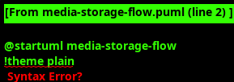

# Armazenamento de mídia (S3)

## Peças
- `MediaStorageService` (`src/shared/media/storage`): `uploadAll` (valida MIME, **assinatura dos bytes** e tamanho por `MediaType`; chave `<env>/<entidade>/<ownerId>/<uuid>.<ext>`), `UploadBatch.discard()` (apaga o que subiu se algo falhar), `deleteAfterCommit(urls)` (remoção depois do commit; falha vai para `media_cleanup_queue`), `deleteStrict(url)`.
- `AwsS3Service.upload`/`delete` (**caminho legado**, ainda usado por ~35 arquivos): chave `<env>/uploads/<uuid>_<nome saneado>`; dentro de uma requisição HTTP o `UploadScopeInterceptor` **adia** as exclusões até o sucesso e descarta os uploads novos se a requisição falhar; exclusão imediata que falha vai para a fila de limpeza.
- `media_cleanup_queue`: reprocessada a cada 10 min (`MediaCleanupService`); após 5 tentativas recebe `failedAt`.
- `MediaReconciliationService`: compara bucket × `media_items`; órfão com mais de 24 h só é removido com `dryRun: false`; referência sem objeto é apenas reportada. O agendamento diário (3h) roda só em dry-run; `POST /media-storage/reconcile` (admin) para execução manual.
- `media_items.storageKey` (nullable): registros antigos continuam resolvendo a chave pela URL.

## Política de upload
- Todo `FileInterceptor`/`FilesInterceptor` tem `limits` (`upload-limits.constants.ts`); nenhum handler sem limite.
- MIME aceito por tipo (`media-storage.constants.ts`); **o conteúdo precisa bater com o MIME declarado** (PNG, JPEG, GIF, WebP, PDF) — HTML renomeado para `.png` é recusado com `MEDIA_CONTENT`.
- URL fora do nosso bucket nunca é lida nem apagada (`keyFromOwnedUrl`); URL sem chave extraível em `delete` é registrada como **erro**.

## Decisão: dois caminhos coexistem
`UploadScopeInterceptor` (legado, por requisição) e `MediaStorageService` (novo, por lote). Os serviços migram para o novo junto do plano de cada feature; enquanto isso o escopo garante "novo → banco → apaga antigo" e "falhou → descarta o novo". A chave do caminho legado não tem prefixo por entidade.

## Garantias testadas
- `aws-s3.service.spec.ts` (chave, colisão, MIME×bytes, adiamento, fila, SSRF), `upload-scope.interceptor.spec.ts`, `media-item-processor.spec.ts`, `media-storage.service.spec.ts`, `media-cascade.architecture.spec.ts` (**todo `delete-*.service` trata a mídia ou está na lista de donos sem mídia**).
- E2E: `e2e/live/security/media-entities`, `media-lifecycle` e `zz-final/bucket-invariants` (sem órfão nem referência quebrada).
