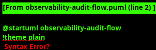

# Observabilidade e auditoria

Plano 12. Registra **erros técnicos** (observabilidade) e **ações** (auditoria) de forma central, sem dado pessoal, e expõe uma consulta só para administradores.

## O que existe

| Peça | Onde | Papel |
|---|---|---|
| Contexto da requisição | `src/core/request-context` | `requestId` gerado no **servidor** (UUID, em `AsyncLocalStorage`), devolvido em `X-Request-Id`; o valor enviado pelo cliente é ignorado. `ComponentsRegistry` descobre módulo/controller/handler sozinho. |
| Logger estruturado | `src/core/observability` | Todo `Logger` do Nest passa por `StructuredLoggerService` (`app.useLogger`). Redação por denylist + metadados por allowlist; listeners de `unhandledRejection`/`uncaughtException`; falha de boot gravada por `writeBootstrapFailure`. |
| Auditoria | `src/core/audit` | `AutomaticActionContextGuard` + `AuditInterceptor` (só `POST/PUT/PATCH/DELETE`) + o `GlobalExceptionFilter` para falhas. Janela de repetição de 60 s (`audit_repeat`). Jobs entram por `runAuditedJob`/`ActionBoundaryService`. |
| Storage | `src/shared/providers/log-storage` | Porta `ObservabilityStoragePort`/`AuditStoragePort`; providers `file` (JSONL, rotação, TTL) e `dynamodb`; fila de entrega com backpressure que **nunca** bloqueia a requisição. |
| Consulta | `src/core/log-records` | `GET/DELETE /log-records/{observability,audit}`. |

## O que é gravado (e o que não é)

Grava: `requestId`, módulo/controller/handler, rota **como template** (`/shelters/:id`), método, status, código de erro, duração, resultado (`succeeded|failed|denied|rejected|not_found`), `actorId` e `actorRole`, `resourceId` (só parâmetros de rota UUID da allowlist `SAFE_RESOURCE_ID_PARAMS`).

**Nunca** grava: corpo, query string, IP, User-Agent, token, senha, e-mail, telefone, CPF, dado de acolhido, **nome do ator** (decisão 6 do plano: só `actorId`).

## Configuração

Blocos “9. OBSERVABILIDADE” e “10. AUDITORIA” de `env/example.env`:

| Variável | Padrão | Observação |
|---|---|---|
| `OBS_STORAGE` / `AUDIT_STORAGE` | `file` | `file` é **recusado** em `staging`/`prod`; lá use `dynamodb`. |
| `OBS_LOCAL_DIR` / `AUDIT_LOCAL_DIR` | `logs` / `audit` | Precisam ser pastas diferentes. Caminho que escapa da raiz é recusado. |
| `OBS_TTL_DAYS` / `AUDIT_TTL_DAYS` | `14` / `365` | O padrão de 1 dia do Clubinho não vale aqui. |
| `AUDIT_DEDUP_SECONDS` | `60` | Janela de repetição. |
| `LOG_DYNAMODB_TABLE_NAME`, `LOG_DYNAMODB_ENDPOINT` | — | Só com `dynamodb` (o endpoint é do DynamoDB Local). |

Configuração inválida derruba o boot com mensagem segura.

## Consulta

Somente administrador **e** com a flag `observability_audit` ligada (desligada por padrão, público `admin`). Ordem dos guards: `JwtAuthGuard` → `AdminRoleGuard` → `FeatureFlagGuard` (401/403 antes de `403 FEATURE_DISABLED`).

- `GET /log-records/observability` e `GET /log-records/audit`: `from`/`to` obrigatórios (≤ **31 dias**, senão `400`), `page`, `limit` (1–100) e filtros allowlisted. Resposta `{ data, meta: { page, limit, totalItems, totalPages } }`.
- `DELETE /log-records/{observability,audit}/:eventId?occurredAt=` e por intervalo; **a exclusão também é auditada**.
- Com storage `file`: **`409`** com `details.code = LOG_9101` (os JSONL existem para análise fora da aplicação). Datas inválidas: `400` com `details.code = VAL_4005`.

## Painel

`/adm/observabilidade-auditoria` (só admin, flag `observability_audit`; fora do menu). Abas Auditoria/Erros, filtros por dia/ator/módulo/resultado, cartões no mobile, diálogo de detalhe e aviso quando o storage é `file`.

## Decisões assumidas (revisar)

| # | Decisão | Onde |
|---|---|---|
| 5 | Só mutações são auditadas; leitura de ficha de acolhido **não** entra (LGPD/volume). | `AUDITED_HTTP_METHODS` |
| 6 | Sem `actorName`, só `actorId`. | `core/request-context`, `core/audit` |
| 7 | TTL: erro técnico 14 dias, auditoria 365. | `LOG_STORAGE_DEFAULTS` |
| — | Código estável de erro em `details.code` (não há classe própria). | `LOG_ERROR_CODES` |
| — | Jobs auditados: `daily-reminders`, `email-outbox-drain` (só passada com trabalho), `media-cleanup-queue` (idem), `media-reconciliation-report`. | `runAuditedJob` |

## Pendente

- Tabela DynamoDB, IAM mínimo e alarmes (taxa de `fatal`, fila de entrega cheia): **exige autorização explícita** (regra 16). O provider `dynamodb` está implementado e coberto por teste com cliente simulado, mas nunca rodou contra uma tabela real.
- Ligar a geração de LLM ao `ActionBoundaryService` quando o Estúdio (planos 43–44) entrar no `AppModule`.

## Testes

Jest: `src/core/{request-context,observability,audit,log-records}`, `src/shared/providers/log-storage` (inclui teste de arquitetura: todo controller no grafo; `WriteAuditEventService` só no interceptor/filtro/boundary; nenhuma entidade TypeORM de log). Playwright: `e2e/live/observability-audit/observability-audit.api.spec.ts`.
