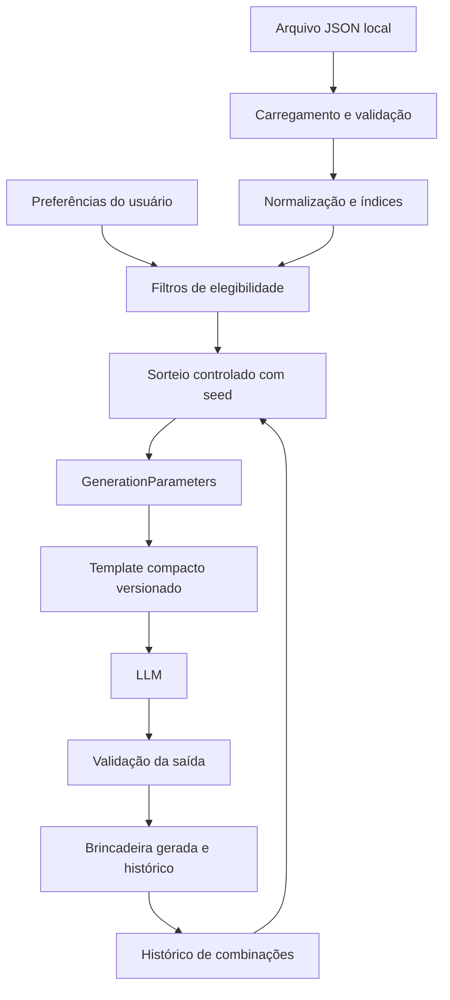

# Plano de implementação — Sorteador de parâmetros para geração de brincadeiras com LLM

**Versão:** 1.0  
**Fonte de dados:** `acervo_brincadeiras_infantis.json` (v1.0.0)  
**Objetivo principal:** gerar parâmetros variados e seguros **localmente**, utilizando o acervo, e enviar ao modelo de linguagem **apenas uma seleção compacta**, sem anexar o JSON completo a cada requisição.

---

## 1. Visão geral

Construir um serviço de sorteio controlado que:

1. Carregue e valide o JSON do acervo na inicialização (ou quando atualizado).
2. Normalize e indexe materiais, categorias e mecânicas em memória ou banco de dados.
3. Receba filtros de contexto (idade, número de participantes, duração, local, disponibilidade de materiais, objetivo e intensidade).
4. Sorteie **2–5 materiais** (configurável), **1 mecânica principal**, eventualmente **1 mecânica complementar** e parâmetros adicionais, respeitando os filtros.
5. Evite combinações inviáveis, inseguras e repetitivas.
6. Monte um objeto pequeno (`GenerationParameters`) com os dados necessários para a criação da brincadeira.
7. Construa um prompt compacto a partir de um **template versionado no backend**.
8. Envie somente as instruções estáveis e os parâmetros selecionados ao LLM, valide a saída e armazene o resultado.

**Princípio arquitetural:** o acervo fica do lado da aplicação; o LLM não precisa conhecer todo o acervo, apenas os itens sorteados e o contexto da brincadeira.

### Fluxo de alto nível



---

## 2. Análise do JSON atual

O arquivo existente possui as seguintes chaves de topo:

- `nome`, `versao`, `idioma`, `descricao`, `metadados`.
- `acervo_materiais`: **16 categorias**, cada uma com `id`, `categoria` e `materiais`.
- `mecanicas`: **15 mecânicas**, cada uma com `id`, `nome` e `acoes`.
- `configuracao_bot`: faixa etária, perguntas, modos, campos da resposta e regras de segurança.
- `prompt_mestre`: prompt extenso de referência — **não enviar inteiro por chamada**.
- `gerador_combinacoes`: opções de quantidade, intensidade, temas, estilos e modelo de prompt.
- `modelo_cadastro_material`, `acervo_brincadeiras_aprovadas`, `modelo_brincadeira_aprovada`.

O catálogo tem **320 entradas de materiais**, com possíveis nomes semelhantes ou repetidos. Cada item existente oferece `id`, `nome`, `quantidade_disponivel` e `observacoes`.

**Limitações a resolver antes de sortear:**

- `quantidade_disponivel: null` significa **não informada**, não disponibilidade confirmada.
- Não há metadados padronizados por item para idade mínima, ambiente, risco, custos e interações possíveis.
- Um nome duplicado em categorias distintas não deve necessariamente aumentar a chance de sorteio.
- Algumas combinações de materiais e atividades exigem regras de segurança específicas.
- O modelo de brincadeira aprovada é um ponto de partida; é preciso acrescentar identidade da combinação, versões e rastreabilidade.

**Estratégia:** preservar o JSON original e adicionar uma etapa de normalização/enriquecimento com metadados opcionais; não quebrar consumidores existentes.

---

## 3. Arquitetura proposta

Componentes sugeridos, independentes de linguagem:

| Componente | Responsabilidade |
|---|---|
| `CatalogLoader` | Ler e validar o arquivo JSON uma única vez por versão. |
| `CatalogNormalizer` | Indexar, normalizar nomes, detectar duplicatas e enriquecer metadados. |
| `EligibilityFilter` | Filtrar materiais e mecânicas conforme idade, espaço, segurança e inventário. |
| `ParameterSampler` | Sortear combinações com seed, pesos e regras de compatibilidade. |
| `NoveltyGuard` | Consultar histórico, reduzir repetições e medir diversidade. |
| `PromptBuilder` | Construir mensagens curtas para o LLM. |
| `LLMAdapter` | Chamar o provedor sem acoplamento ao algoritmo de sorteio. |
| `OutputValidator` | Validar schema, materiais usados, segurança e coerência. |
| `ActivityRepository` | Registrar brincadeiras, parâmetros, avaliações e versão de prompt. |

**MVP:** arquivo JSON + índices em memória + armazenamento leve (SQLite, por exemplo).  
**Evolução:** PostgreSQL, fila assíncrona e observabilidade, se o volume justificar.

Para aplicação web: frontend envia filtros; **backend faz o sorteio e chama o LLM**. A chave da API do provedor nunca deve ficar no frontend.

---

## 4. Modelos de dados

### 4.1 Solicitação do usuário: `GenerationRequest`

```json
{
  "idade_min": 6,
  "idade_max": 10,
  "participantes": 12,
  "duracao_minutos": 20,
  "ambiente": "interno",
  "intensidade": "moderada",
  "tema": "livre",
  "modo": "surpresa",
  "quantidade_materiais": 3,
  "materiais_permitidos_ids": ["mat-02-01", "mat-01-01", "mat-03-01"],
  "politica_disponibilidade": "somente_confirmados",
  "seed": 42718
}
```

> IDs ilustrativos: sempre resolver os valores contra o catálogo real. `materiais_permitidos_ids` é opcional; quando informado, restringe o universo. A política `somente_confirmados` exige inventário preenchido e suficiente; para acervos não inventariados, usar explicitamente `permitir_desconhecidos_com_aviso` e exigir confirmação antes da atividade.

### 4.2 Resultado do sorteador: `GenerationParameters`

```json
{
  "sorteio_id": "uuid",
  "catalogo_versao": "1.0.0",
  "prompt_versao": "1.0.0",
  "seed": 42718,
  "contexto": {
    "faixa_etaria": "6-10",
    "participantes": 12,
    "duracao_minutos": 20,
    "ambiente": "interno",
    "intensidade": "moderada",
    "tema": "livre"
  },
  "materiais": [
    {"id": "mat-02-01", "nome": "Bambolês", "quantidade_sugerida": 3},
    {"id": "mat-01-01", "nome": "Bolinhas de plástico", "quantidade_sugerida": 12},
    {"id": "mat-03-01", "nome": "Baldes pequenos", "quantidade_sugerida": 2}
  ],
  "mecanica_principal": "Precisão",
  "mecanica_secundaria": "Cooperação",
  "objetivo": "coordenação e trabalho em equipe",
  "restricoes": [
    "Sem arremessos em direção a pessoas",
    "Evitar objetos pequenos inadequados à idade",
    "Respeitar as quantidades disponíveis"
  ],
  "fingerprint_combinacao": "hash-normalizado"
}
```

**Nota:** quantidades sugeridas são calculadas por regras próprias e limitadas ao estoque; nunca inferir estoque a partir de `null`. O exemplo apresenta valores ilustrativos, não garante disponibilidade real.

### 4.3 Saída estruturada esperada do LLM: `GeneratedActivity`

```json
{
  "nome": "Missão dos Alvos Coloridos",
  "resumo": "Uma missão cooperativa para levar bolas até os alvos.",
  "faixa_etaria": "6-10",
  "participantes": 12,
  "duracao_minutos": 20,
  "local": "interno",
  "materiais": [
    {"id": "mat-02-01", "nome": "Bambolês", "quantidade": 3},
    {"id": "mat-01-01", "nome": "Bolinhas de plástico", "quantidade": 12},
    {"id": "mat-03-01", "nome": "Baldes pequenos", "quantidade": 2}
  ],
  "preparacao": ["Posicione os bambolês como áreas-alvo."],
  "passos": ["Divida as crianças em equipes.", "Explique a missão e faça uma rodada de teste."],
  "regras": ["Não lançar bolas na direção das pessoas."],
  "condicao_termino": "Todas as equipes completam a missão.",
  "adaptacoes": {
    "facil": "Aproxime os alvos.",
    "dificil": "Aumente a distância gradualmente.",
    "inclusiva": "Permita lançar, rolar ou entregar a bola."
  },
  "surpresa": "Troca de alvos na segunda rodada.",
  "cuidados": ["Manter o piso livre de obstáculos."]
}
```

Usar validação estrutural rigorosa (JSON Schema, Zod, Pydantic ou equivalente). Não confiar em texto livre como formato de integração.

---

## 5. Algoritmo de sorteio

### 5.1 Filtragem inicial

1. Ler somente o catálogo local indexado.
2. Obter materiais permitidos pelo usuário ou política de inventário.
3. Excluir itens incompatíveis com idade, ambiente, restrições, espaço ou risco.
4. Excluir mecânicas incompatíveis com a intensidade e contexto.
5. Agrupar equivalentes por identificador canônico, sem perder IDs de origem.
6. Verificar se há itens suficientes antes de sortear.

### 5.2 Amostragem ponderada

- Definir a quantidade de **tipos** de materiais entre 2 e 5 (não confundir com unidades físicas).
- Priorizar diversidade de categorias, quando apropriado.
- Aplicar pesos configuráveis (disponibilidade, custo, acessibilidade, popularidade, novidade, variedade).
- Sortear sem reposição, usando um gerador pseudoaleatório reproduzível com `seed`.
- Escolher a mecânica principal **compatível** com os materiais; opcionalmente incluir uma secundária.
- Sortear também tema, objetivo e intensidade quando não forem informados pelo usuário.
- **Nunca sortear restrições de segurança para removê-las**; são sempre obrigatórias.

### 5.3 Compatibilidade e segurança

Manter regras de domínio separadas, por exemplo:

- `requires`: requisitos físicos de uma atividade/mecânica.
- `excludes`: incompatibilidades.
- `min_age` e `max_age`: indicação etária validada, quando disponível.
- `allowed_environments`: interno/externo/ambos.
- `supervision`: cuidados e supervisão.
- `quantity_policy`: cálculo da quantidade necessária.

Para dados ausentes, aplicar política **conservadora**; não considerar automaticamente seguro.

### 5.4 Repetição e novidade

- Fingerprint exato: hash estável dos IDs canônicos dos materiais ordenados + mecânicas + tema + versão do algoritmo.
- Repetição exata: bloquear dentro de uma janela configurável (por exemplo, últimas 50 gerações).
- Similaridade: calcular índice de Jaccard entre conjuntos de materiais e complementar com mecânicas e tema.
- Se similaridade alta (limiar inicialmente sugerido: `0.8`), reduzir o peso ou rejeitar.
- Também diversificar **regras/estrutura da brincadeira**, porque trocar apenas os objetos não garante novidade.
- Usar no máximo `N` tentativas e implementar fallback: relaxar primeiro novidade e preferências opcionais, **nunca segurança, idade ou disponibilidade exigida**.

### 5.5 Pseudocódigo

```ts
function sortear(req: GenerationRequest): GenerationParameters {
  const rng = seededRandom(req.seed ?? generateSecureSeed());
  const catalogo = catalogCache.getValidated();
  const candidatos = filtrarMateriais(catalogo, req);
  const mecanicas = filtrarMecanicas(catalogo, req);

  assert(candidatos.length >= quantidadeSolicitada(req));
  assert(mecanicas.length > 0);

  for (let tentativa = 0; tentativa < MAX_TENTATIVAS; tentativa++) {
    const materiais = sortearMateriaisSemReposicao(candidatos, req, rng);
    const compativeis = mecanicas.filter(m => compatibilidade(m, materiais, req));
    if (!compativeis.length) continue;

    const principal = escolherPonderado(compativeis, rng);
    const secundaria = escolherSecundariaOpcional(compativeis, principal, rng);
    const params = montarParametros(req, materiais, principal, secundaria, rng);

    if (validarSeguranca(params) && noveltyGuard.aceita(params)) {
      return params;
    }
  }

  throw new NoViableCombinationError(
    "Não foi possível gerar uma combinação válida; revise filtros opcionais."
  );
}
```

**Importante:** o código acima é pseudocódigo de arquitetura, não implementação executável. `seededRandom`, `catalogCache` e as outras funções devem ser implementadas e testadas.

---

## 6. Como enviar pouco conteúdo ao LLM

### 6.1 Estratégia preferencial

Enviar duas mensagens:

1. **Instrução estável curta** (system/developer, conforme a API): papel, formato JSON, segurança, proibição de inventar materiais e critérios de qualidade.
2. **Payload dinâmico enxuto** (user): apenas `GenerationParameters` essenciais.

Não enviar `acervo_materiais`, `mecanicas` completos nem o `prompt_mestre` extenso do JSON por requisição.

**Observação:** uma instrução estável pode continuar sendo enviada pela API em cada requisição, conforme o provedor. Manter o texto pequeno e aproveitar **prompt caching** do provedor quando disponível; cache não significa que o servidor do modelo conhece automaticamente seu catálogo.

### 6.2 Instrução estável sugerida

```text
Você cria brincadeiras infantis originais, divertidas, viáveis, inclusivas e seguras.
Use exclusivamente os materiais listados no payload, respeitando suas quantidades.
Não acrescente materiais obrigatórios não fornecidos.
Respeite idade, ambiente, participantes, duração, intensidade e restrições.
Combine as mecânicas de maneira criativa; não apenas renomeie jogos conhecidos.
Descreva preparação, passos, regras, término, adaptações, surpresa e cuidados.
Responda SOMENTE com um objeto JSON válido no schema GeneratedActivity.
```

### 6.3 Payload dinâmico compacto (exemplo)

```json
{
  "idade": "6-10",
  "criancas": 12,
  "minutos": 20,
  "local": "interno",
  "intensidade": "moderada",
  "tema": "livre",
  "materiais": ["3 bambolês", "12 bolinhas de plástico", "2 baldes pequenos"],
  "mecanicas": ["precisão", "cooperação"],
  "objetivo": "coordenação e equipe",
  "restricoes": ["não arremessar em pessoas", "sem materiais adicionais obrigatórios"]
}
```

O LLM recebe só os recursos sorteados, não todas as centenas de opções. IDs podem ser preservados em campo compacto se forem necessários para integrar a saída ao inventário.

### 6.4 Budget e eficiência

- Estabelecer teto configurável de tamanho para prompt, payload e resposta.
- Não repetir informações estáveis em vários campos.
- Limitar número de materiais, regras e variações por solicitação.
- Usar `response_format` com schema/structured output quando o provedor permitir.
- Registrar tokens de entrada, saída e cache efetivamente reportados pela API.
- Fazer validação local antes e depois da chamada; não enviar ao LLM o que pode ser resolvido em código.
- Se o prompt exceder o orçamento, **simplificar descrição opcional**, mas manter segurança, materiais e contexto.

---

## 7. API HTTP sugerida

| Método | Rota | Finalidade |
|---|---|---|
| `GET` | `/api/play/catalog/summary` | Resumo de categorias, mecânicas e versão. |
| `GET` | `/api/play/materials` | Pesquisa e filtros dos materiais cadastrados. |
| `POST` | `/api/play/parameters/draw` | Sorteia e devolve parâmetros **sem chamar o LLM**. |
| `POST` | `/api/play/activities/generate` | Sorteia ou aceita um `sorteio_id` validado e chama o LLM. |
| `GET` | `/api/play/activities/{id}` | Consulta brincadeira já gerada. |
| `POST` | `/api/play/activities/{id}/feedback` | Avaliação e observações. |
| `GET` | `/api/play/history` | Histórico e filtros para evitar repetições. |

### Exemplo de chamada para o sorteador

```http
POST /api/play/parameters/draw
Content-Type: application/json

{
  "idade_min": 6,
  "idade_max": 10,
  "participantes": 12,
  "duracao_minutos": 20,
  "ambiente": "interno",
  "intensidade": "moderada",
  "tema": "livre",
  "quantidade_materiais": 3,
  "politica_disponibilidade": "permitir_desconhecidos_com_aviso"
}
```

**Fluxo UX:** clicar em **Sortear** não consome tokens do LLM; apresentar uma prévia dos parâmetros, permitir **Sortear novamente** e só depois clicar em **Criar brincadeira** para fazer a chamada paga.

Na geração, o backend deve recuperar e validar o `sorteio_id` persistido com versão do catálogo, usuário/sessão e expiração, sem confiar em parâmetros adulterados pelo cliente.

---

## 8. Interface sugerida

**Filtros**

- Faixa etária, participantes, duração, ambiente e energia.
- Tema: livre, bíblico, educativo ou outro.
- Quantidade de tipos de materiais (2/3/4/5).
- Materiais disponíveis e materiais proibidos.
- Modos: surpresa, poucos materiais, sem materiais, circuito, cooperativo, gincana etc.

**Área de sorteio**

- Materiais sorteados com quantidades.
- Mecânica principal e complementar.
- Objetivo e restrições.
- Botões: **Sortear novamente**, **Trocar um material**, **Fixar este material**, **Criar brincadeira**.

**Resultado**

- Nome, instruções, preparação, regras e adaptações.
- Botões: **Salvar**, **Avaliar**, **Gerar outra com os mesmos materiais** e **Imprimir**.

Ao fixar um material, o próximo sorteio deve preservar esse item e sortear apenas os demais; impedir combinações impossíveis e apresentar mensagens úteis.

---

## 9. Persistência sugerida

Entidades/tabelas:

- `catalog_versions`: versão, hash do arquivo, data de carga, status de validação.
- `materials`: ID canônico, nome, categoria, metadados e status.
- `inventory`: material ID, quantidade confirmada, local e atualização.
- `mechanics`: ID, nome e regras de compatibilidade.
- `draws`: `sorteio_id`, seed, filtros, parâmetros, fingerprint, versão do algoritmo e data.
- `activities`: resposta validada, `sorteio_id`, modelo utilizado, tokens e versões.
- `activity_feedback`: avaliação, observações e indicação de repetição.

Para MVP, é aceitável manter **catálogo no arquivo JSON** e persistir apenas inventário, sorteios e atividades. Evitar duas fontes de verdade para o mesmo dado.

---

## 10. Validação, segurança e confiabilidade

1. Validar formato do JSON e IDs únicos por origem.
2. Usar IDs canônicos para deduplicação e rastrear IDs de origem.
3. Tratar quantidade desconhecida separadamente de zero e de estoque disponível.
4. Aplicar regras de idade e segurança **antes** do sorteio e **depois** da geração.
5. Usar geração com JSON estruturado, limites de tamanho, timeout e retries limitados.
6. Não aceitar materiais extras obrigatórios fora do sorteio sem autorização.
7. Tratar dados de catálogo e campos de usuário como **dados**, nunca como instruções privilegiadas para o LLM.
8. Proteger credenciais no servidor; usar autenticação, rate limiting e orçamento por usuário quando aplicável.
9. Registrar versão do prompt/modelo/algoritmo para auditoria e reprodução.
10. Não afirmar que uma atividade é segura somente porque o LLM disse que é; manter políticas determinísticas e revisão humana para casos de maior risco.

---

## 11. Testes obrigatórios

### Testes unitários

- Carregar 16 categorias e 15 mecânicas sem erro.
- Filtrar corretamente por inventário, idade e local.
- Não repetir o mesmo tipo de material num sorteio, após deduplicação.
- Não exceder quantidades confirmadas.
- Reproduzir o mesmo sorteio com a mesma seed, mesma versão do catálogo, mesmo contexto e mesmo snapshot de histórico/pesos.
- Preservar materiais fixados pelo usuário.
- Não relaxar restrições obrigatórias no fallback.

### Testes de integração

- Sorteio retorna JSON validável sem acionar o provedor LLM.
- Geração monta somente o payload compacto esperado.
- Saída inválida do LLM produz erro tratado ou retry controlado.
- Histórico bloqueia repetições exatas.
- Atualização do catálogo invalida índices antigos de forma segura.

### Testes de qualidade

- Executar lote de 100–1000 sorteios com cenários variados.
- Medir proporção de combinações válidas, distribuição de categorias, taxa de repetição, diversidade de mecânicas e latência.
- Medir tokens por brincadeira, custo médio, taxa de erros do LLM e avaliação humana das atividades.
- Revisar uma amostra com educadores/recreadores para verificar diversão, clareza, execução real e segurança.

---

## 12. Fases de implementação

### Fase 1 — Catálogo e normalização

- [ ] Criar parser/validator do `acervo_brincadeiras_infantis.json`.
- [ ] Indexar materiais e mecânicas por ID.
- [ ] Normalizar duplicações e definir IDs canônicos.
- [ ] Criar metadados mínimos para filtros e compatibilidade.
- [ ] Definir política de disponibilidade (`null` ≠ disponível).

**Pronto quando:** o backend consulta o acervo com segurança e identifica elegibilidade.

### Fase 2 — Sorteador sem LLM (MVP)

- [ ] Implementar filtros.
- [ ] Implementar sorteio determinístico com seed.
- [ ] Implementar seleção ponderada de materiais e mecânicas.
- [ ] Implementar regras de compatibilidade e fallback.
- [ ] Expor `POST /api/play/parameters/draw`.
- [ ] Criar testes unitários e lote de sorteios.

**Pronto quando:** o sistema devolve combinações utilizáveis sem consumir tokens.

### Fase 3 — Integração LLM

- [ ] Escrever instrução estável curta e versionada.
- [ ] Criar `PromptBuilder` com payload compacto.
- [ ] Implementar adapter do provedor.
- [ ] Configurar structured output e schema.
- [ ] Validar brincadeira e vincular a `sorteio_id`.
- [ ] Medir tokens, custo, erros e latência.

**Pronto quando:** uma combinação pode virar uma brincadeira estruturada sem enviar o JSON completo.

### Fase 4 — Interface e histórico

- [ ] Tela de filtros e inventário.
- [ ] Sorteio, re-sorteio e fixação de materiais.
- [ ] Prévia antes de gerar.
- [ ] Salvar, consultar e avaliar brincadeiras.
- [ ] Deduplicação e variedade orientadas pelo histórico.

**Pronto quando:** o usuário consegue operar o fluxo de ponta a ponta.

### Fase 5 — Refinamento

- [ ] Melhorar pesos a partir de avaliações reais.
- [ ] Adicionar tags de habilidades, espaços e acessibilidade.
- [ ] Criar geração de variantes usando os mesmos materiais.
- [ ] Adicionar observabilidade, limites e proteção contra abuso.
- [ ] Implementar importação de novas versões do catálogo.

---

## 13. Critérios de aceite do MVP

- O catálogo é lido no backend e **não é enviado integralmente** ao LLM.
- O endpoint de sorteio funciona sem qualquer chamada ao LLM.
- O retorno contém materiais, quantidades, mecânica, contexto, restrições e seed.
- O sorteio respeita inventário confirmado ou avisa explicitamente sobre disponibilidade desconhecida.
- Há mecanismo para recusar combinações inseguras ou inviáveis.
- O usuário pode re-sortear antes de consumir tokens.
- A geração aceita somente sorteios válidos e devolve uma brincadeira em JSON estruturado.
- A brincadeira utiliza apenas materiais permitidos e não excede quantidades autorizadas.
- Os registros permitem analisar histórico, repetição e custo por chamada.
- A solução tem testes automatizados para os fluxos principais.

---

## 14. Decisões de design recomendadas

1. **Primeiro escolha os parâmetros no código; depois use o LLM apenas para criatividade.**
2. **Não use o LLM para selecionar materiais a partir do catálogo inteiro.** A seleção é mais barata, reproduzível e auditável no backend.
3. **Separe sorteio de geração.** Sorteios gratuitos do ponto de vista de tokens; geração paga sob ação explícita do usuário.
4. **Mantenha instruções estáveis curtas e versionadas.** O prompt mestre atual serve como referência para derivá-las, não como payload obrigatório.
5. **Enriqueça o inventário incrementalmente.** Não bloqueie toda a arquitetura esperando metadados perfeitos, mas adote fallback seguro e confirmação explícita para itens desconhecidos.
6. **Meça qualidade, não apenas variedade aparente.** Uma brincadeira nova precisa mudar a experiência, não só o nome.

### Próxima tarefa de desenvolvimento (primeiro PR)

Implementar `CatalogLoader`, `CatalogNormalizer`, `EligibilityFilter`, `ParameterSampler` e `POST /api/play/parameters/draw`, com testes. O retorno deve ser `GenerationParameters`, com IDs canônicos, seed e versão do catálogo. **Nenhuma chamada ao LLM nessa primeira entrega.**
