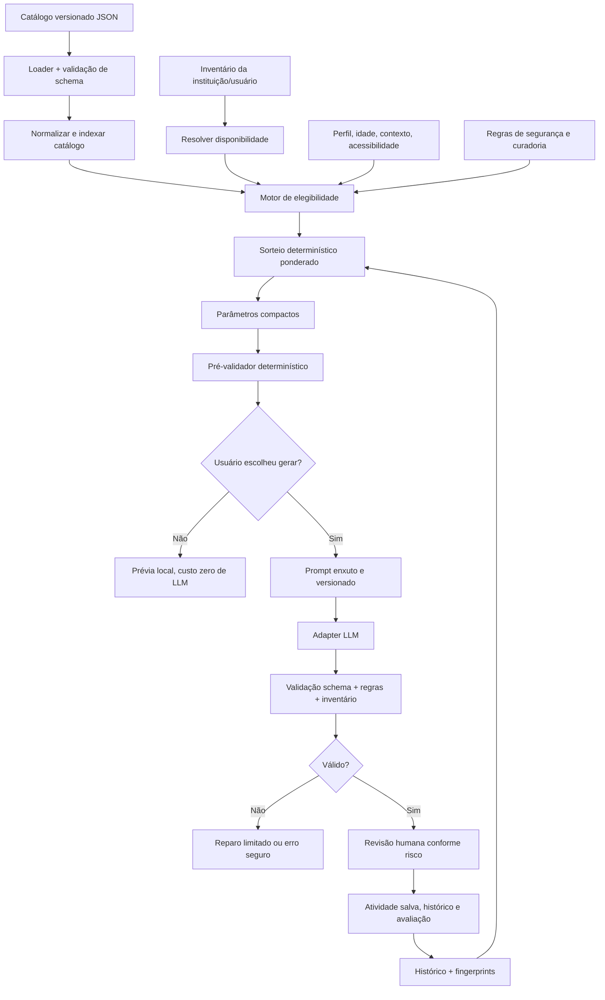

# Plano de implementação — Sorteador inteligente universal de atividades lúdicas

**Versão:** 2.0.0  
**Data:** 2026-11-20  
**Catálogo de referência:** `acervo_atividades_ludicas_universal_v2.json`  
**Público:** bebês, primeira infância, crianças, pré-adolescentes, adolescentes, adultos e grupos intergeracionais.  
**Princípio central:** **o catálogo permanece no backend; somente o pacote compacto de parâmetros selecionados e regras necessárias é enviado ao LLM**.

---

## 1. Objetivo e critérios de sucesso

Construir um sistema de criação de **brincadeiras, dinâmicas, jogos, oficinas e atividades lúdicas** que escolha parâmetros adequados ao público e ao contexto, com sorteios diversos, auditáveis e seguros, e que use um LLM **somente na etapa de redigir a atividade**.

- **Catálogo local:** 1.040 entradas em 36 categorias, 40 mecânicas e 9 perfis etários na v2 inicial; contagem corresponde a entradas, não itens físicos distintos.
- **Uso multi-idade:** bebês acompanhados, crianças, adolescentes e adultos; suporte a participantes de idades misturadas.
- **Inventário real separado:** distinguir recursos conhecidos dos recursos realmente disponíveis.
- **Custo:** nenhuma chamada ao LLM ao apenas sortear, filtrar, favoritar ou comparar parâmetros.
- **Segurança antes da criatividade:** filtros determinísticos de adequação e riscos, checagem de acessibilidade e revisão humana nos casos definidos.
- **Qualidade:** registrar avaliações, evitar repetições sem bloquear criatividade e produzir JSON de resposta com schema estável.
- **Observabilidade:** saber por que determinado material foi incluído/excluído e rastrear seed, versões, riscos e consumo de tokens.

### Metas iniciais (ajustáveis após teste)

| Indicador | Objetivo inicial |
|---|---|
| Sorteios sem LLM | 100% |
| Materiais fora do inventário confirmado, no modo `confirmado` | 0 |
| Materiais pendentes de curadoria para bebês incluídos automaticamente | 0 |
| Resultado reproduzível com mesma seed, filtros e versões | 100% |
| JSON sintaticamente válido devolvido pelo LLM | ≥ 98% após reparo controlado |
| Combinações repetidas dentro da janela recente | ≤ 10%, quando houver diversidade suficiente |
| Explicação para universo vazio | 100% |
| Chamadas ao LLM não solicitadas pelo usuário | 0 |

**Nota:** metas são propostas de teste, não desempenho já medido.

## 2. Arquitetura recomendada



**Sugestão de stack:** TypeScript (Node.js) com Fastify ou NestJS, validação Zod/Ajv, PostgreSQL para persistência, Redis **opcional** para cache e controle de taxa. A arquitetura também funciona sem Redis, usando cache em memória num único processo. Frontend React/Next.js, se desejado. As regras de segurança devem ficar no backend, não apenas no prompt.

## 3. Catálogo: estruturas e migração v1 → v2

### 3.1 O que existe no JSON v2

- `acervo_materiais`: **36 categorias** com **1.040 entradas**; IDs da v1 preservados.
- `mecanicas`: **40 mecânicas**; IDs da v1 preservados.
- `publicos`: **9 faixas** definidas em meses (limites explícitos); perfis são sugestões e não rótulos de capacidade individual.
- `contextos_e_parametros`: locais, objetivos, modalidades, intensidades, acessibilidade, níveis, temas e estruturas.
- `regras_seguranca`: riscos, gatilhos, mitigações e política global.
- `regras_por_publico`: cuidados e exigências de revisão.
- `inventario`: semântica de disponibilidade e exemplo de registro físico.
- `curadoria_materiais`: campos para revisão individual e estados `pendente`, `revisado`, `aprovado`, `bloqueado`.
- `indice_canonico_materiais`, `grupos_de_nomes_repetidos`: deduplicação transversal.
- `configuracao_sorteador`, `parametros_llm`, `fluxo_geracao`, `modelos`, `modos`, `migracao`.

**Importante:** o catálogo lista possibilidades; **não é um catálogo de produtos certificados, nem uma declaração de que cada item é adequado a determinada idade**. Mesmo que o nome pareça inofensivo, a segurança depende de dimensões, marca, componentes soltos, estado do material, atividade proposta, contexto e supervisão. Antes de uso com bebês e crianças pequenas, cada item deve receber revisão específica de segurança e adequação.

### 3.2 Compatibilidade e deduplicação

1. Preservar IDs legados para não quebrar referências de brincadeiras já salvas.
2. Normalizar caracteres para busca (casefold, acentos), mantendo nome de exibição original.
3. Usar `canonical_key` para sugerir equivalências e **não contar duas vezes a mesma possibilidade** em sorteios; permitir equivalência manual por `canonical_material_id`.
4. Não fundir automaticamente produtos com o mesmo nome que diferem em tamanho, composição ou segurança.
5. Não alterar o JSON inteiro para registrar quantidade: **inventário pertence a armazenamento separado**.
6. Não usar índice textual ou tags para presumir idade mínima; somente dados de curadoria aprovados.
7. Criar migração explícita e testes de idempotência para futuros upgrades.

### 3.3 Modelo persistente de dados

| Entidade | Chave / campos essenciais |
|---|---|
| `CatalogVersion` | `version`, `checksum`, `publishedAt` |
| `Category` | `id`, `name`, `order` |
| `Material` | `id`, `canonicalId`, `name`, `categoryIds`, `type`, `synonyms` |
| `MaterialReview` | `materialId`, `ageMinMonths`, `ageMaxMonths`, `riskIds`, `conditions`, `reviewerId`, `status`, `reviewedAt` |
| `InventoryItem` | `tenantId`, `materialId`, `quantity`, `condition`, `location`, `verifiedAt` |
| `Mechanic` | `id`, `name`, `actions`, `ageReview`, `environmentFlags` |
| `AudienceProfile` | `id`, `minMonths`, `maxMonths`, `guidelines` |
| `GenerationRequest` | `id`, `tenantId`, `filters`, `seed`, `catalogVersion` |
| `ParameterBundle` | `id`, `requestId`, `materials`, `mechanics`, `constraints`, `fingerprint`, `scoring` |
| `GeneratedActivity` | `id`, `bundleId`, `llmModel`, `promptVersion`, `result`, `reviewStatus` |
| `ActivityFeedback` | `activityId`, `score`, `ageGroup`, `durationActual`, `notes` |
| `GenerationUsage` | `requestId`, `tokensInput`, `tokensOutput`, `latencyMs`, `costEstimate` |

Usar `tenantId` se vários grupos/organizações compartilharem o sistema. Isolar inventário, históricos e feedback por tenant.

## 4. Modelo de públicos — não confundir idade e capacidade

| Perfil | Idades | Exemplos de atividades | Precauções |
|---|---|---|---|
| Bebês A | 0–11 meses | exploração visual, voz, livros de tecido, interação cuidador-bebê | acompanhamento contínuo; sem partes pequenas, água livre, cordões ou deslocamento forçado |
| Bebês B | 12–23 meses | causa e efeito, exploração segura, brincadeiras simples com responsável | supervisão direta; nunca presumir habilidades motoras |
| Primeira infância | 2–3 anos | jogos de classificação, imitação, grandes encaixes | instruções curtas, objetos grandes e íntegros |
| Crianças | 4–6 anos | memória visual, faz de conta, circuitos simples | adequar intensidade e ambiente |
| Crianças | 7–9 anos | pistas, construção, cooperação, gincanas leves | oferecer níveis e formas de participação |
| Pré-adolescentes | 10–12 anos | enigmas, estratégia, desafios em equipe | evitar humilhação e pressão excessiva |
| Adolescentes | 13–17 anos | dedução, escape game sem confinamento, debate, improviso | não exigir exposição íntima, contato físico ou gravações |
| Adultos | 18–59 anos | team building, negociação, escape game, esportes recreativos, trivia | conhecer contexto e oferecer alternativas de intensidade |
| Adultos 60+ | 60+ anos | jogos de estratégia, atividades intergeracionais, expressão e movimento sob escolha | não estereotipar; adaptar ao indivíduo, não à idade |

**Modelo robusto:** idade expressa em meses (bebês) ou convertida para meses (demais); guardar distribuição de idades para grupo misto; separar `functionalNeeds` e `accessibilityOptions` da idade. Não inferir deficiência, condição médica, autonomia ou preferência apenas pela faixa etária.

### 4.1 Quando o grupo é misto

Exemplos: familiares com bebês e adultos; crianças e adolescentes; adultos intergeracionais. O sistema deve distinguir:

- **Atividade simultânea compartilhada**, em que todos conseguem participar com papéis apropriados.
- **Estações paralelas** por nível, mantendo objetivo comum.
- **Atividade com responsável**, quando o bebê participa apenas com o adulto.
- **Níveis alternativos de desafio**, sem segregar ou infantilizar os demais.

Evitar selecionar a mecânica principal somente pela média etária. Validar cada segmento presente ou devolver a necessidade de divisão em estações.

## 5. Inventário real versus catálogo hipotético

`quantidade_disponivel: null` significa **desconhecida**; não significa disponível. Modos:

1. `confirmado`: somente itens com quantidade positiva e estado adequado, curadoria elegível e reserva possível.
2. `informado_na_requisicao`: o usuário declara os materiais para aquela sessão; ainda se verifica segurança e compatibilidade.
3. `catalogo_hipotetico`: para inspiração; sinalizar explicitamente o que precisaria obter, não afirmar que existe.
4. `sem_materiais`: zero materiais físicos; permitir voz, gestos e interação, adequando ao público.

**Reserva de quantidade:** ao planejar sessões simultâneas, controlar disponibilidade por local, horário e quantidade comprometida. Um sorteio não deve reservar materiais; a reserva ocorre somente quando o usuário confirmar o planejamento.

## 6. Curadoria e segurança determinística

### 6.1 Pipeline de curadoria

1. Novo item entra como `pendente`.
2. Revisor identifica o produto concreto ou recurso (dimensões, integridade, materiais, partes removíveis, instruções do fabricante, idade de uso, ambiente, necessidade de supervisão).
3. Registra riscos conhecidos e condições de uso. Não marcar `aprovado` apenas por heurística de nome.
4. Se faltar informação para bebês ou crianças pequenas, manter inelegível para sorteio automático nesse público.
5. Revisar quando houver substituição, dano, alteração de uso ou nova informação.

### 6.2 Restrições duras (nunca relaxadas por algoritmo de diversidade)

- **Asfixia e sufocamento:** excluir peças pequenas e elementos que possam envolver o pescoço em atividades para bebês e crianças pequenas.
- **Água:** para bebês, não sortear atividades com água livre; para outras idades, avaliar local, profundidade, supervisão contínua e riscos de escorregamento.
- **Quedas e colisões:** proibir olhos vendados em jogos de corrida, obstáculos e deslocamento.
- **Químicos/calor/eletricidade:** sem desafios com substâncias perigosas, chama ou ferramentas inadequadas; oficinas especializadas exigem verificação humana.
- **Alimentos:** identificar alergias/restrições e riscos de engasgo; alimentação não é elemento obrigatório.
- **Som/luz:** permitir volume baixo, pausas e rotas sem sobrecarga sensorial.
- **Contato e privacidade:** nada de toque não consentido, exposição constrangedora, fotos sem autorização ou coleta compulsória de informações íntimas.
- **Competição:** evitar punição, eliminação humilhante, castigos físicos e desafios de risco.

**Fallback seguro:** se não houver recursos elegíveis, responder `NO_ELIGIBLE_COMBINATION` e explicar os motivos. Pode propor alternativas sem materiais ou revisão de inventário, **mas nunca reduzir restrições duras**.

## 7. Motor de sorteio: seleção com filtros, pesos e seed

### 7.1 Entrada — filtros

```ts
type AudienceId =
  | 'bebe_0_11m' | 'bebe_12_23m' | 'primeira_infancia_2_3'
  | 'criancas_4_6' | 'criancas_7_9' | 'pre_adolescentes_10_12'
  | 'adolescentes_13_17' | 'adultos_18_59' | 'adultos_60_mais';

type DrawRequest = {
  tenantId: string;
  audiences: AudienceId[];
  ageRangeMonths?: { min: number; max: number };
  participantCount: number;
  environment: string;
  durationMinutes: number;
  objective: string;
  energy: 'baixa' | 'moderada' | 'alta';
  inventoryMode: 'confirmado' | 'informado_na_requisicao' | 'catalogo_hipotetico' | 'sem_materiais';
  declaredMaterials?: { materialId: string; quantity: number }[];
  accessibilityOptions?: string[];
  theme?: string;
  mode?: string;
  materialCount?: number;
  mechanicCount?: number;
  seed?: number;
  exclusions?: { materialIds?: string[]; mechanicIds?: string[] };
};
```

### 7.2 Algoritmo

1. Validar payload e normalizar faixa etária (incluindo misturas).
2. Carregar snapshot imutável do catálogo, curadoria e inventário com versões/checksums.
3. Interseccionar requisitos de segurança de **todos** os perfis presentes.
4. Resolver disponibilidade material e capacidade necessária, quando aplicável.
5. Aplicar restrições de ambiente, duração, energia, alergias/conforto informados e acessibilidade.
6. Selecionar mecânica principal compatível com público/objetivo, seguida de complementares.
7. Criar conjunto de materiais compatível com mecânicas. Evitar sorteio ingênuo de objetos sem propósito conjunto.
8. Usar PRNG com seed para reproduzir a escolha; não usar `Math.random()` sem injetar PRNG quando reprodutibilidade for exigida.
9. Aplicar penalidade moderada para fingerprints semelhantes e recompensa para diversidade de mecânica/estrutura.
10. Checar consistência final, produzir `ParameterBundle` e registrar diagnóstico.
11. **Não chamar LLM durante sorteio.**

### 7.3 Critérios para scoring (depois dos filtros duros)

```text
score = 0.30 * compatibilidade_material_mecanica
      + 0.25 * aderencia_objetivo
      + 0.25 * novidade_estrutural
      + 0.20 * diversidade_de_categorias
      - penalidade_de_repeticao
```

Valores são heurísticas iniciais. Ajustar com dados de avaliações, sem permitir que qualquer peso anule uma exclusão de segurança. Um material não deve ser elegível apenas porque tem pontuação alta.

### 7.4 Compatibilidade entre objetos e mecânicas

Criar tabela `MaterialMechanicCompatibility(materialId, mechanicId, interactionType, suitabilityScore, conditions, reviewStatus)`. Exemplo: bambolê + coordenação = delimitar área; bambolê + precisão = lançar argolas (desde que a aplicação específica seja adequada). Curadoria valida possibilidade prática e riscos. Para ideias novas, permitir combinações não tabeladas **somente para adultos em modo hipotético e com revisão**, ou submeter à curadoria antes de uso; não improvisar automaticamente com bebês.

### 7.5 Antirrepetição sem padronizar demais

Criar fingerprint com `audiences + canonicalMaterialIds + mechanicIds + structure + objective + theme`, todos em ordem canônica. Separar repetição exata de similaridade. Manter memória curta (últimas 100) e longa (preferências/avaliações). Penalizar itens populares para abrir espaço a recursos esquecidos; nunca penalizar até excluir a única combinação segura. Repetição intencional é permitida em modo de treino.

### 7.6 Exemplo de pseudocódigo

```ts
function drawParameters(req: DrawRequest, ctx: Context): ParameterBundle {
  const snapshot = ctx.loadSnapshot(req.tenantId);
  const normalized = validateAndNormalize(req);
  const audienceRules = resolveAllAudienceRules(normalized);
  const eligibleMechanics = filterMechanics(snapshot, normalized, audienceRules);
  const eligibleMaterials = filterMaterials(snapshot, normalized, audienceRules);
  if (!eligibleMechanics.length) throw noEligible('mechanics');
  if (!eligibleMaterials.length && normalized.inventoryMode !== 'sem_materiais') {
    throw noEligible('materials');
  }
  const rng = seededRandom(normalized.seed ?? ctx.generateSeed());
  const candidates = constructCompatibleBundles({
    mechanics: eligibleMechanics,
    materials: eligibleMaterials,
    normalized,
    rng
  });
  const ranked = scoreAndPenalizeHistory(candidates, snapshot.history);
  const bundle = weightedChoose(ranked, rng);
  assertSafeAndAvailable(bundle, normalized, snapshot);
  return {
    ...bundle,
    seed: rng.seed,
    catalogVersion: snapshot.catalogVersion,
    inventoryVersion: snapshot.inventoryVersion,
    rulesVersion: snapshot.rulesVersion,
    fingerprint: canonicalFingerprint(bundle)
  };
}
```

**Observação:** pseudocódigo; funções devem ser implementadas e testadas. `generateSeed()` deve gravar a seed real, que será retornada ao usuário/API.

## 8. Objeto compacto enviado ao LLM

O backend faz o sorteio usando catálogo completo, mas monta um contrato **pequeno**, contendo apenas o necessário.

```json
{
  "bundleVersion": "2.0",
  "audiences": ["adolescentes_13_17"],
  "ageRange": "13–17 anos",
  "participants": 16,
  "durationMinutes": 30,
  "environment": "sala_grande",
  "objective": "cooperacao",
  "energy": "moderada",
  "structure": "investigacao",
  "theme": "misterio",
  "mechanics": ["deducao", "comunicacao", "cooperacao"],
  "materials": [
    { "id": "exemplo-001", "name": "Cartas de pistas", "quantity": 16 },
    { "id": "exemplo-002", "name": "Quadro branco", "quantity": 1 }
  ],
  "accessibility": ["participacao_sentada", "instrucao_visual"],
  "constraints": ["sem eliminacao", "sem contato fisico obrigatorio", "sem confinamento"],
  "outputLanguage": "pt-BR"
}
```

IDs `exemplo-*` são ilustrativos, não IDs do catálogo. No sistema real, devem ser substituídos por IDs selecionados e verificados; nomes/quantidades são derivados do snapshot de inventário.

### Template de instrução estável

```text
Você cria atividades lúdicas originais, divertidas, inclusivas e viáveis.
Respeite estritamente o público, o ambiente, a duração, as mecânicas,
os materiais e as restrições fornecidas no objeto JSON de entrada.
Não invente materiais extras. Não force o uso de itens incompatíveis.
Não inclua desafios perigosos, humilhantes ou exposição pessoal obrigatória.
Responda apenas JSON válido conforme o schema solicitado.
Se a combinação não for viável, retorne status=inviavel e um motivo claro.
```

**Economia real de tokens:** guardar instrução fixa no backend e transmitir apenas o pacote compacto por geração. Dependendo do provedor, a instrução fixa também será transmitida a cada chamada; **não prometer que ela fica gratuitamente na memória do modelo**. Usar prompt caching quando disponível, medir tokens de entrada/saída, adotar respostas estruturadas e evitar anexos extensos.

## 9. Contrato da resposta do LLM

```ts
type ActivityResult =
  | {
      status: 'ok';
      name: string;
      summary: string;
      audience: string[];
      participants: { min: number; max: number };
      durationMinutes: number;
      materials: { materialId: string; quantity: number; purpose: string }[];
      setup: string[];
      steps: string[];
      rules: string[];
      endCondition: string;
      variations: { easier: string; harder: string; accessible: string };
      risksAndMitigations: { risk: string; mitigation: string }[];
      facilitatorChecklist: string[];
    }
  | { status: 'inviavel'; reason: string; suggestedRelaxations?: string[] };
```

O backend deve validar schema, quantidades, IDs e restrições. **O texto do LLM não é certificado de segurança.** A validação semântica automatizada é complementar; revisão humana continua necessária onde exigida.

### Estratégia de erro/repair

- Payload inválido: uma tentativa curta de correção estrutural, preferencialmente com erro de schema explícito, depois falhar.
- Material não sorteado: rejeitar, sem substituir silenciosamente.
- Material indisponível: rejeitar e solicitar novo sorteio ou replanejamento.
- Violação de risco: bloquear e exigir curadoria/revisão, não simplesmente confiar em autorrevisão do mesmo LLM.
- Inviabilidade declarada: apresentar ao usuário os motivos e opções permitidas.

## 10. APIs REST sugeridas

| Método | Endpoint | Objetivo | LLM? |
|---|---|---|---|
| `GET` | `/v1/catalog/metadata` | Contagens, categorias e versões | Não |
| `GET` | `/v1/catalog/materials` | Busca paginada e filtros | Não |
| `GET` | `/v1/catalog/mechanics` | Mecânicas indexadas | Não |
| `GET` | `/v1/audiences` | Públicos e diretrizes | Não |
| `PUT` | `/v1/inventory/:materialId` | Atualizar quantidades verificadas | Não |
| `POST` | `/v1/material-reviews` | Cadastrar revisão de segurança | Não |
| `POST` | `/v1/draws` | Sortear bundle e diagnóstico | Não |
| `POST` | `/v1/draws/:id/reroll` | Sortear outro usando filtros prévios | Não |
| `POST` | `/v1/activities/generate` | Enviar bundle validado ao LLM | **Sim** |
| `GET` | `/v1/activities` | Histórico e filtros | Não |
| `POST` | `/v1/activities/:id/feedback` | Avaliar e aprender | Não |
| `POST` | `/v1/activities/:id/approve` | Aprovação humana | Não |
| `GET` | `/v1/usage` | Tokens, custos e métricas | Não |

Padrões: autenticação, autorização por tenant, idempotency key em geração, rate limits, paginação e erros com códigos estáveis. Não aceitar `tenantId` do cliente sem validar pertencimento. Registrar trilha de auditoria da revisão de materiais.

### Exemplo `POST /v1/draws`

```json
{
  "audiences": ["adultos_18_59"],
  "participantCount": 20,
  "environment": "empresa",
  "durationMinutes": 25,
  "objective": "integracao_de_equipes",
  "energy": "baixa",
  "inventoryMode": "confirmado",
  "materialCount": 3,
  "seed": 8821
}
```

A resposta traz `drawId`, `seed`, `versions`, `bundle`, `diagnostics` e `estimatedInputTokens` (**estimativa**, não cobrança real). A geração recebe apenas um `drawId` validado no backend, impedindo que o cliente altere parâmetros e burle as regras.

## 11. Interface do usuário

### Etapa A — Configurar

- Seleção dos públicos (bebê, criança, adolescente, adulto; seleção múltipla para intergeracional).
- Idade exata ou intervalos; capacidade/acessibilidade como preferências independentes.
- Participantes, local, tempo, nível de energia, objetivo e tema.
- Inventário confirmado versus modo de inspiração.
- Quantidade de materiais, mecânicas, modalidades e exclusões.
- Modo “surpresa”, “sem materiais”, “baixo custo” etc.

### Etapa B — Sortear sem pagar LLM

- Cards de **materiais sorteados**, quantidades e finalidades sugeridas.
- **Mecânica principal** e complementares, estrutura, tema e regras-chave.
- Indicador de elegibilidade/curadoria e alternativas acessíveis.
- Botão **Sortear novamente** e opção **travar um parâmetro** (ex.: manter bambolê, variar o resto).
- Explicação para materiais não elegíveis ou estoque insuficiente.
- Botão para **copiar o pacote compacto** e visualizar a estimativa de tokens.

### Etapa C — Gerar e revisar

- Botão **Gerar atividade** é a única ação que chama o LLM.
- Exibir atividade estruturada, passos, materiais, cuidados e adaptações.
- Em público infantil, solicitar revisão/confirmação do responsável/facilitador antes de executar.
- Salvar, avaliar, duplicar com alterações, comparar versões e registrar feedback de uso.

## 12. Persistência, cache e concorrência

- JSON versionado e validado no boot; índices in-memory por categoria, nome canônico, mecânica e risco.
- PostgreSQL guarda inventários, revisões, solicitações, bundles, atividades, avaliações e auditoria.
- Redis opcional para cache de consultas e rate limit; **não** fonte de verdade de inventário.
- Snapshots imutáveis no sorteio: `catalogChecksum`, `reviewVersion`, `inventoryVersion`, `rulesVersion`.
- Ao gerar, revalidar estoque/curadoria se a versão tiver mudado; devolver conflito tratável se necessário.
- Usar transações para reservas de materiais e controle de concorrência por tenant/sessão.
- Logs não devem incluir perfis pessoais sensíveis, dados de crianças ou conteúdo privado desnecessário.

## 13. Qualidade, testes e observabilidade

### Unitários

- Conversão de idades em meses e bordas dos perfis.
- Deduplicação de nomes, preservação de IDs e conteúdo original da v1.
- `null`, `0`, `>0` para inventário; modos confirmado e hipotético.
- Determinismo da seed; estabilidade condicionada às versões dos dados.
- Regras rígidas de risco; casos proibidos não entram na seleção.
- Scoring/novidade e fallback sem candidatos.

### Integração

- Bebê + item pendente de revisão ⇒ **não sorteado**.
- Bebê + água livre/peça pequena/cordão ⇒ **bloqueio**.
- Adultos + materiais confirmados + baixa intensidade ⇒ combinação válida.
- Grupo intergeracional ⇒ validação para todos os subgrupos.
- Inclusão sentada ⇒ oferecer mecanismo/variante sem exigir deslocamento.
- Inventário com dois usuários concorrentes ⇒ não prometer o mesmo estoque após reserva.
- LLM citando item não sorteado ⇒ resposta rejeitada.
- LLM retornando JSON malformado ⇒ reparo limitado/falha clara.

### Avaliação humana

- Revisar uma amostra estratificada por perfil etário e modalidade.
- Avaliar **diversão**, viabilidade, clareza, originalidade, inclusão e segurança.
- Manter registro de rejeições e motivo, usar feedback para ajustar compatibilidade e pesos.
- Testes com menores somente com supervisão responsável e procedimentos apropriados, sem coleta desnecessária de dados pessoais.

### Métricas

`draws_total`, `draws_no_candidate`, `draws_blocked_by_risk`, `llm_generations`, `llm_validation_errors`, `tokens_in_out`, `estimated_cost`, `activities_approved`, `approval_rate`, `material_coverage`, `novelty_index`, `user_rating`, `p95_draw_latency`.

## 14. Segurança, privacidade e governança

- Não enviar nomes, fotos, diagnósticos ou dados pessoais de participantes ao LLM; enviar só parâmetros agregados e necessidades funcionais estritamente necessárias.
- Controles de acesso por organização, papéis `viewer`, `facilitator`, `curator`, `admin`.
- Revisão por curador para materiais e regras; versões e auditoria de alterações.
- Validar entradas do usuário para prompt injection; dados do catálogo são **dados**, não instruções de sistema.
- Evitar produzir dinâmicas coercitivas, humilhantes ou perigosas.
- Avaliar conformidade aplicável de proteção de dados, especialmente ao lidar com menores; minimizar retenção e aplicar controles de consentimento quando necessário.
- Moderar conteúdo do usuário e saída do LLM, além da checagem determinística.
- Não permitir geração para grupos vulneráveis quando a curadoria esteja incompleta; explicar bloqueio e caminhos seguros.

## 15. Organização do código

```text
src/
  catalog/
    catalog-loader.ts
    catalog-schema.ts
    catalog-index.ts
    canonicalization.ts
  audience/
    audience-rules.ts
    mixed-group.ts
  inventory/
    inventory.service.ts
    reservation.service.ts
  curation/
    material-review.service.ts
    risk-engine.ts
  drawing/
    filters.ts
    compatibility.ts
    seeded-rng.ts
    scorer.ts
    dedup.ts
    draw.service.ts
  generation/
    parameter-bundle.schema.ts
    compact-prompt.ts
    llm.adapter.ts
    response-validation.ts
    activity.service.ts
  history/
    fingerprint.ts
    feedback.service.ts
  api/
    catalog.controller.ts
    drawing.controller.ts
    generation.controller.ts
  observability/
    metrics.ts
    audit.ts
assets/
  acervo_atividades_ludicas_universal_v2.json
  prompts/
    activity-system.v2.txt
migrations/
tests/
  unit/
  integration/
  property/
```

## 16. Fases de implementação e entregáveis

### Fase 0 — Auditoria de dados e definição de produto

- Validar JSON e contagens; mapear itens potencialmente duplicados, ambíguos ou perigosos.
- Definir restrições de idade, responsabilidades de curadoria e contrato mínimo.
- Definir se haverá organizações múltiplas e infraestrutura necessária.

**Aceite:** schemas, matriz de riscos e critérios de revisão aprovados.

### Fase 1 — Core de catálogo, públicos e inventário

- Loader, normalizador, índice e migração de IDs v1.
- Entidades de inventário, política de nulos, status de curadoria e API de listagem.
- CRUD controlado de materiais e revisão.

**Aceite:** nenhum material desconhecido é tratado como disponível ou automaticamente seguro.

### Fase 2 — Sorteador offline inteligente

- Filtros rígidos por perfil, acessibilidade, contexto e estoque.
- Mecânicas compatíveis, PRNG determinístico, scoring, antirrepetição e fingerprints.
- Endpoint de sorteio sem LLM, reroll e travamento de parâmetros.

**Aceite:** sorteios reproduzíveis e diagnósticos de exclusão transparentes.

### Fase 3 — Integração econômica com LLM

- Bundle mínimo, template versionado, adapter multi-provedor opcional, output estruturado e validação.
- Controles de token, latência, taxa, idempotência, custo e erros.

**Aceite:** só o botão de gerar chama LLM e a resposta só usa materiais permitidos.

### Fase 4 — Frontend, histórico, aprovação e acessibilidade

- Tela de filtros, cards de sorteio, botão gerar e formulário de feedback.
- Fluxos adaptados a bebê, criança, adolescente, adulto e grupos mistos.
- Aprovação/curadoria, favoritos, bibliotecas de atividades e exportação.

**Aceite:** uso completo por facilitador sem tocar no JSON manualmente.

### Fase 5 — Aprendizado e otimização

- Recalibrar pesos com feedback agregado.
- Métricas, testes A/B controlados, sugestão de compras opcional e novas categorias.
- Prompt caching, relatórios de uso e mecanismos de geração por lote.

**Aceite:** melhoria mensurável de diversidade/avaliação sem relaxar regras duras.

## 17. Backlog priorizado

**P0 — Obrigatório antes de produção:** schemas, migração, inventário separado, curadoria, regras etárias/risco, bloqueios, sorteador determinístico, pacote compacto, validação da saída, revisão humana para atividades com menores, testes.

**P1 — Qualidade do MVP:** busca por sinônimos, seleção multimodal de acessibilidade, histórico, fingerprints, travar parâmetros, feedback, UI de filtros, métricas e observabilidade.

**P2 — Evolução:** gestão multi-tenant avançada, recomendação adaptativa, compatibilidade por grafo, modo intergeracional com estações, integrações com calendário/estoque, reserva e avaliação continuada.

## 18. Exemplos de cenários aceitos

**Bebê de 8 meses:** ambiente em casa, 1 bebê e 1 adulto, 5 minutos, objetivo vínculo. Sortear preferencialmente interação visual/sonora suave e materiais seguros **previamente revisados**, ou brincadeira sem objetos. Não propor água livre, peças pequenas, corrida ou desafio com vendas.

**Crianças de 6–8 anos:** sala ampla, 15 participantes, 20 minutos, cooperação. Sortear materiais confirmados e mecânicas de memória + cooperação, com alternativa sentada e sem eliminação.

**Adolescentes de 14–16 anos:** 20 participantes, 35 minutos, mistério. Sortear dedução + trabalho em equipe + comunicação, cartas e quadro confirmados, sem confinamento real nem exposição pessoal.

**Adultos em empresa:** 18 participantes, 25 minutos, baixa intensidade. Sortear negociação, criação coletiva ou raciocínio, com rodadas de colaboração e sem constrangimentos.

**Grupo intergeracional:** idades variadas, 30 minutos. Sortear construção de histórias ou quiz com papéis complementares e níveis alternativos. Caso exista bebê, o responsável conduz a participação dele; não aplicar o mesmo nível de desafio a todos.

## 19. Critérios de pronto (Definition of Done)

- [ ] JSON v2 carrega e valida sem erros.
- [ ] IDs de itens anteriores permanecem estáveis.
- [ ] Duplicatas canônicas são detectadas sem fundir itens distintos indevidamente.
- [ ] Há um mecanismo de curadoria humana para segurança e adequação etária.
- [ ] Bebês e crianças pequenas não recebem materiais pendentes ou perigosos automaticamente.
- [ ] Modo confirmado nunca usa material com quantidade nula ou zero.
- [ ] Grupos mistos passam pela validação de todos os perfis presentes.
- [ ] Mesmos filtros, seed e versões produzem mesmo sorteio.
- [ ] Reroll não chama o LLM.
- [ ] `generate` envia apenas bundle compacto e instruções estáveis necessárias.
- [ ] Saída do LLM é estruturada, validada e rejeitada quando viola os parâmetros.
- [ ] Não existem reparos que contornem restrições duras.
- [ ] Feedback, assinatura, versões, consumo e decisão de aprovação são rastreáveis.
- [ ] O frontend expõe opções acessíveis e avisos de necessidade de supervisão.

---

## 20. Decisões técnicas essenciais

1. **Catálogo ≠ inventário ≠ curadoria.** São três domínios distintos.
2. **Sorteio local ≠ geração por IA.** Só a geração consome tokens do modelo.
3. **Idade ≠ habilidade.** Perfis são guias; acessibilidade e capacidades vêm de preferências e observação, não de suposições.
4. **Segurança é filtro duro, não sugestão de prompt.** Nenhum algoritmo de ranking pode ignorá-la.
5. **Versão e seed fazem parte do resultado.** Reprodutibilidade é um requisito do produto.
6. **Diversidade está na mecânica e no fluxo da brincadeira, não apenas no título.**
7. **Saída de LLM é candidata à aprovação, não instrução validada automaticamente.**

**Resultado esperado:** plataforma modular, auditável e expansível, capaz de gerar atividades para todas as faixas etárias sem anexar o catálogo inteiro ao LLM e sem tratar bebês, adolescentes e adultos como um público único.
